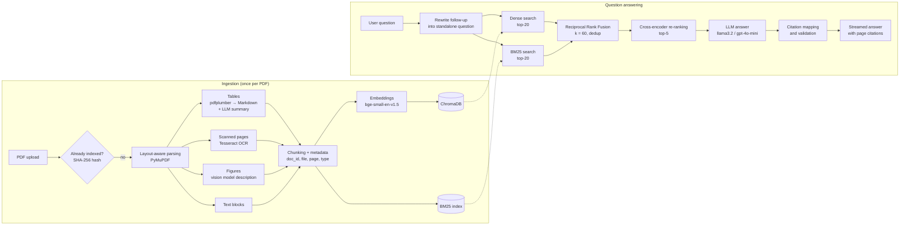

# Inkwell RAG: Autonomous Multimodal RAG Platform for Complex Documents

Upload PDFs (technical reports, whitepapers, manuals, financial reports, including scanned
pages, tables and diagrams) and ask questions in a Streamlit chat. Every answer cites the
exact document and page it came from, and each cited passage can be opened to check it.

Runs **fully offline** with Ollama and no API key. OpenAI can be switched on from the
sidebar or `.env`.

## Features

- **Layout-aware parsing**: text blocks in reading order with headings, page numbers on everything
- **Tables**: extracted with pdfplumber, stored as Markdown with a one-line LLM summary, never split
- **Figures and charts**: cropped from the page and described by a vision model (llava / gpt-4o-mini)
- **Scanned pages**: detected automatically and read with Tesseract OCR
- **Hybrid retrieval**: dense (BGE + ChromaDB) and keyword (BM25) search merged with Reciprocal Rank Fusion
- **Cross-encoder re-ranking** (`bge-reranker-base`) of the merged candidates
- **Verified citations**: the model cites `[S1]` labels, code maps them to `[file.pdf, p. N]`
  and removes any label that was not in the context, so page numbers are never invented
- **Follow-up questions** rewritten into standalone questions using the last 4 turns
- **Evaluation suite**: Hit@5, Recall@5, MRR, citation correctness, LLM-judge faithfulness, latency, RAM

## Architecture



| Layer | Technology |
|---|---|
| Language / UI | Python 3.11, Streamlit |
| Orchestration | LangChain (core, community, chroma, ollama, openai) |
| Vector DB | ChromaDB (persistent, local) |
| Embeddings | `BAAI/bge-small-en-v1.5` (sentence-transformers); optional OpenAI `text-embedding-3-small` |
| Sparse search | BM25 (`rank_bm25`) |
| Re-ranker | `BAAI/bge-reranker-base`; fallback `cross-encoder/ms-marco-MiniLM-L-6-v2` |
| LLM | Ollama `llama3.2` (local); optional OpenAI `gpt-4o-mini` |
| Vision | Ollama `llava` (local); `gpt-4o-mini` with OpenAI |
| PDF parsing | PyMuPDF, pdfplumber, pytesseract |
| Config / tests | pydantic-settings + `.env`, pytest |

## Project structure

```
Inkwell-RAG/
├── app.py                      # Streamlit app
├── requirements.txt
├── .env.example                # copy to .env
├── src/
│   ├── config.py               # all settings, provider switch, paths
│   ├── ingestion/
│   │   ├── pdf_parser.py       # text blocks, headings, tables, images, OCR per page
│   │   ├── table_extractor.py  # tables -> Markdown + summary
│   │   ├── image_captioner.py  # figures -> PNG + vision-model description
│   │   └── chunker.py          # chunks with metadata
│   ├── indexing/
│   │   ├── embeddings.py       # BGE / OpenAI embeddings
│   │   ├── vector_store.py     # ChromaDB wrapper, embedding-model check
│   │   ├── bm25_index.py       # BM25 build, save, load, search
│   │   └── indexer.py          # pipeline: parse -> chunk -> Chroma + BM25; delete; rebuild
│   ├── retrieval/
│   │   ├── hybrid_retriever.py # dense + BM25, Reciprocal Rank Fusion
│   │   └── reranker.py         # cross-encoder re-ranking
│   ├── generation/
│   │   ├── llm.py              # Ollama / OpenAI chat and vision models, health checks
│   │   ├── prompts.py          # system, QA, rewrite and judge prompts
│   │   └── rag_chain.py        # rewrite -> retrieve -> generate -> verify citations
│   └── utils/
│       ├── logging.py          # one shared logger (console + data/logs/app.log)
│       └── hashing.py          # file hash for duplicate detection
├── evaluation/
│   ├── eval_set.json           # 31 questions with expected answer, file and pages
│   ├── make_sample_docs.py     # builds the 3 sample PDFs in sample_docs/
│   ├── run_eval.py             # runs the evaluation
│   ├── charts.py               # report charts
│   └── reports/                # summary.md, CSV files, PNG charts
├── tests/                      # pytest unit tests
└── data/                       # created at runtime, not in git (uploads, Chroma, images, logs)
```

## Setup

You need **Python 3.11**, **Ollama** and **Tesseract**. The first run downloads the embedding
model (~130 MB) and the re-ranker (~1.1 GB) from Hugging Face; after that everything works offline.

### Windows 10/11 (PowerShell)

```powershell
# 1. Get the code and create a virtual environment
git clone https://github.com/Gautam-codex/Inkwell-RAG.git
cd Inkwell-RAG
py -3.11 -m venv .venv
.\.venv\Scripts\Activate.ps1
python -m pip install --upgrade pip
pip install -r requirements.txt

# 2. Ollama (local LLM and vision model)
winget install Ollama.Ollama
ollama pull llama3.2      # chat model, ~2 GB
ollama pull llava         # vision model for figures, ~4.7 GB

# 3. Tesseract OCR (for scanned pages)
winget install UB-Mannheim.TesseractOCR

# 4. Configuration
Copy-Item .env.example .env
# In .env set:  TESSERACT_CMD=C:\Program Files\Tesseract-OCR\tesseract.exe
```

If `Activate.ps1` is blocked, run once: `Set-ExecutionPolicy -Scope CurrentUser RemoteSigned`

### Linux (Ubuntu/Debian)

```bash
git clone https://github.com/Gautam-codex/Inkwell-RAG.git
cd Inkwell-RAG
python3.11 -m venv .venv && source .venv/bin/activate
pip install --upgrade pip && pip install -r requirements.txt

curl -fsSL https://ollama.com/install.sh | sh
ollama pull llama3.2 && ollama pull llava

sudo apt install tesseract-ocr
cp .env.example .env
```

### Using OpenAI instead (optional)

Set `PROVIDER=openai` and `OPENAI_API_KEY=...` in `.env`, or choose **OpenAI** in the sidebar
and paste the key there (kept only for the browser session). Embeddings stay local unless
you also set `EMBEDDING_PROVIDER=openai` (this requires re-indexing).

> **Note on `llama3.2-vision`:** recent Ollama versions (0.40+) cannot load it
> ("unknown model architecture: mllama"), so `llava` is the default vision model.

## Run

```bash
streamlit run app.py
```

Open http://localhost:8501. Make sure Ollama is running (its tray icon on Windows, or `ollama serve`).

1. Open **Add PDF documents**, choose one or more PDFs and click **Index**.
   A progress bar shows pages parsed, figures described and chunks embedded.
2. Ask a question in the chat. The answer streams in with citations like `[report.pdf, p. 12]`.
3. Open a source under the answer to see the passage, its scores, and the figure image.

The sidebar has the provider and model choice, retrieval sliders (top-k, top-n), chunk size,
the document list (delete, search only in selected documents), **Clear chat** and a
**System status** panel.

### Command-line tools

Useful for checking each stage on your own PDFs:

```bash
python -m src.ingestion.pdf_parser report.pdf --show-text   # per-page text / tables / images / OCR
python -m src.ingestion.chunker report.pdf                  # chunks and their metadata
python -m src.ingestion.image_captioner report.pdf          # figure descriptions
python -m src.indexing.indexer path/to/pdfs                 # index a folder (also --list, --delete ID, --rebuild)
python -m src.retrieval.hybrid_retriever "your question"    # ranked chunks with every score (--mode dense|bm25|hybrid)
python -m src.generation.rag_chain                          # chat in the terminal
```

## Evaluation

```bash
python -m evaluation.run_eval                    # full run (~60 min on a laptop CPU)
python -m evaluation.run_eval --skip-generation  # retrieval only (~3 min)
python -m evaluation.run_eval --limit 5          # quick check
```

The evaluation builds three sample PDFs (`evaluation/sample_docs/`: a pump manual, an annual
report and a battery whitepaper), indexes them in a separate folder (`evaluation/eval_data/`,
your own index is untouched) and answers the 31 questions in `evaluation/eval_set.json`
(13 text, 11 table, 5 figure, 2 scanned-page).

It writes `evaluation/reports/summary.md`, CSV files and four charts:

| Metric | Meaning |
|---|---|
| Hit@5 | share of questions with a correct page in the top 5 results |
| Recall@5 | share of the expected pages found in the top 5 |
| MRR | mean of 1 / rank of the first correct result |
| Citation correctness | share of answers that cite an expected page |
| Faithfulness / correctness | LLM-judge scores, 1-5 |
| Latency | mean and p95 for retrieval and generation |
| Peak RAM | this process and Ollama |

Results of the latest run (Intel CPU, 12 threads, 17 GB RAM, no GPU):

| Set-up | Hit@5 | Recall@5 | MRR |
|---|---|---|---|
| Dense only | 1.00 | 0.968 | 0.890 |
| BM25 only | 1.00 | 1.000 | 0.952 |
| Hybrid (RRF) | 1.00 | 0.984 | 0.903 |
| Hybrid + re-ranker | 1.00 | 0.984 | 0.917 |

Citation correctness 96.8%, faithfulness 4.71 / 5, correctness 4.90 / 5. Mean time per question:
retrieval 17.7 s (mostly re-ranking), generation 30.1 s. See [`evaluation/reports/summary.md`](evaluation/reports/summary.md).

To evaluate on your own PDFs, put them in `evaluation/sample_docs/`, list them under
`"documents"` in `eval_set.json` and add questions in the same format.

## Tests

```bash
python -m pytest -q
```

55 unit tests cover parsing, OCR, tables, chunk metadata, BM25 build/load/search, Chroma
indexing, duplicates and delete, RRF fusion, re-ranking order and low-RAM fallback, citation mapping and validation,
streaming, question rewriting, figure captioning fallbacks and the evaluation metrics.
They use small fake models, so they run in about 20 seconds without Ollama.

## Running on an 8 GB RAM laptop

Measured peaks: the app uses about 2.2 GB; Ollama about 3 GB for `llama3.2` and about 5 GB more
while `llava` is loaded. The vision model is unloaded 30 seconds after the last figure, so the
two are not kept in memory together. Already built in:

- models load once and are shared (`st.cache_resource`), and only when first needed
- embeddings are computed in batches of 32 and stored in batches of 64
- the re-ranker switches to the small MiniLM model automatically below 10 GB RAM

Recommended `.env` for 8 GB:

```ini
OLLAMA_NUM_CTX=4096                                     # smaller context, less RAM
RERANKER_MODEL=cross-encoder/ms-marco-MiniLM-L-6-v2     # ~14x faster on a CPU
MAX_FIGURES_PER_DOC=10                                  # captioning is ~75 s per figure on a CPU
```

Close other heavy programs while indexing documents with many figures, or set
`CAPTION_FIGURES=false` to skip figure descriptions.

## Troubleshooting

| Problem | Fix |
|---|---|
| "Ollama is not running" | Start the Ollama app (or `ollama serve`), then refresh the page |
| "Model 'llama3.2' is not pulled" | `ollama pull llama3.2` |
| Figures not described | `ollama pull llava`; check **System status** in the sidebar |
| "unknown model architecture: mllama" | Use `OLLAMA_VISION_MODEL=llava` |
| Scanned pages give no text | Install Tesseract and set `TESSERACT_CMD` in `.env` |
| "The index was built with another embedding model" | Click **Rebuild the index now**, or switch the model back |
| "is password-protected" | Remove the password (e.g. print to PDF) and upload again |
| First start is slow | The models are being downloaded / loaded; later starts are faster |
| Answers are slow | Use the MiniLM re-ranker and `OLLAMA_NUM_CTX=4096` (see above) |

Logs are written to `data/logs/app.log`.

## Screenshots

<!-- Replace these with your own screenshots, saved in docs/screenshots/ -->

| | |
|---|---|
|  |  |
| *Uploading PDFs with progress* | *Answer with page citations and source expanders* |
|  |  |
| *A cited figure with its image* | *Sidebar: provider, sliders, documents* |

## Limitations

- Two-column pages may interleave lines from both columns.
- pdfplumber finds tables drawn with ruling lines; tables laid out only with spacing are indexed as text.
- Charts drawn as vector graphics (not images) are not described; their labels are indexed as text.
- Small local models sometimes misread chart values or forget a citation; OpenAI models are more accurate.
- On a CPU, the `bge-reranker-base` re-ranker adds several seconds per question.
