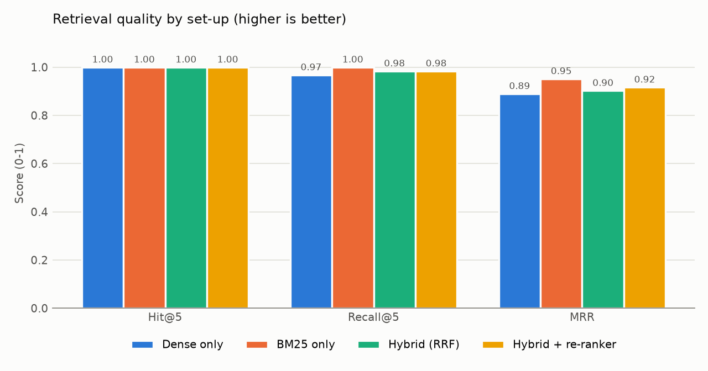
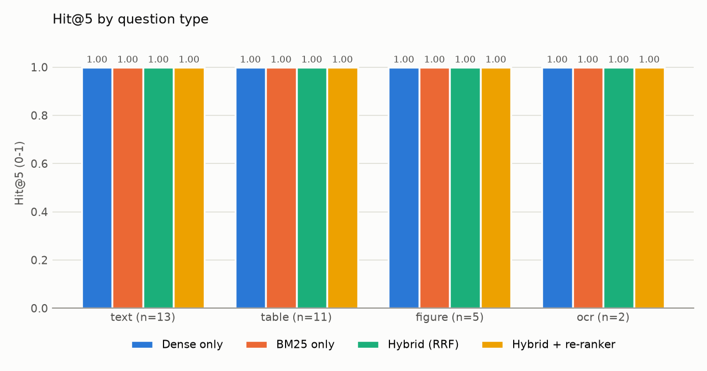
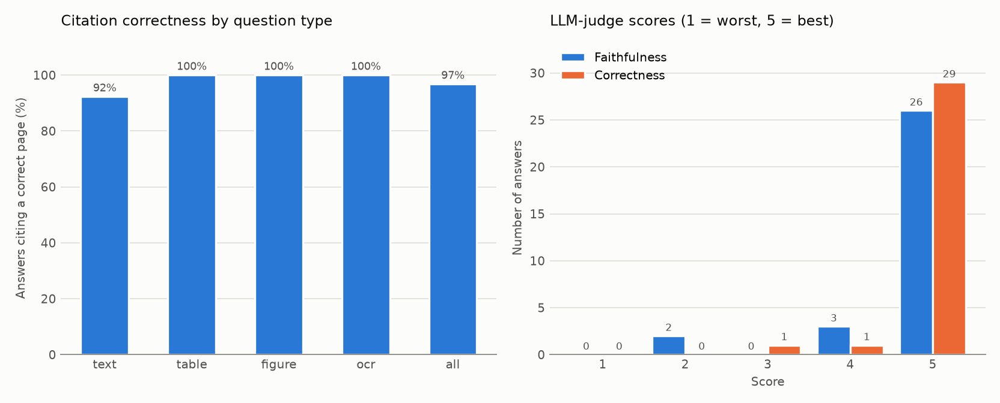
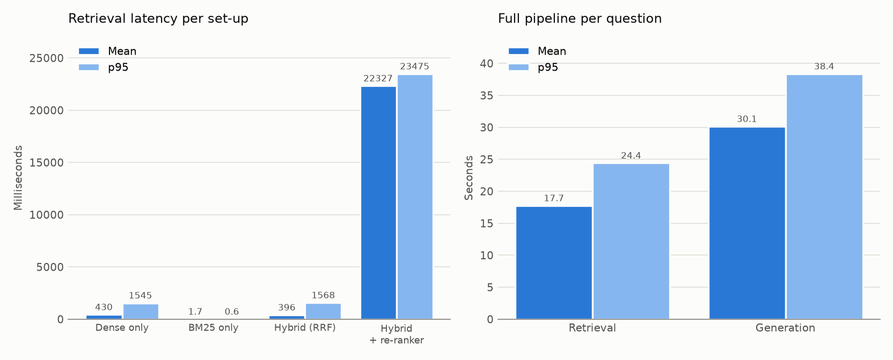

# Evaluation report

Run on 2026-10-31 22:55 · 31 questions over 3 documents · top-k = 5

Models: LLM `llama3.2` · embeddings `BAAI/bge-small-en-v1.5` · re-ranker `BAAI/bge-reranker-base` · vision `llava`

Machine: Intel64 Family 6 Model 154 Stepping 3, GenuineIntel, 12 logical CPUs, 17 GB RAM, Windows 10

## 1. Retrieval: comparing the four set-ups

A result counts as correct when it comes from the expected file and one of the expected pages.

| Set-up | Hit@5 | Recall@5 | MRR | Mean latency (ms) | p95 latency (ms) |
|---|---|---|---|---|---|
| Dense only | 1.0 | 0.968 | 0.89 | 430.3 | 1545.3 |
| BM25 only | 1.0 | 1.0 | 0.952 | 1.7 | 0.6 |
| Hybrid (RRF) | 1.0 | 0.984 | 0.903 | 396.3 | 1568.3 |
| Hybrid + re-ranker | 1.0 | 0.984 | 0.917 | 22327.3 | 23475.1 |

### Hit@5 by question type

| Set-up | text (n=13) | table (n=11) | figure (n=5) | ocr (n=2) |
|---|---|---|---|---|
| Dense only | 1.0 | 1.0 | 1.0 | 1.0 |
| BM25 only | 1.0 | 1.0 | 1.0 | 1.0 |
| Hybrid (RRF) | 1.0 | 1.0 | 1.0 | 1.0 |
| Hybrid + re-ranker | 1.0 | 1.0 | 1.0 | 1.0 |

## 2. Answers (full pipeline: hybrid + re-ranker + LLM)

| Measure | Result |
|---|---|
| Questions answered without error | 31 / 31 |
| Citation correctness (cited page includes an expected page) | 96.8% |
| Faithfulness, LLM judge (1-5) | 4.71 (n=31) |
| Correctness vs expected answer, LLM judge (1-5) | 4.9 (n=31) |

Citation correctness by question type: text 92.3%, table 100.0%, figure 100.0%, ocr 100.0%

## 3. Latency and memory

| Stage | Mean (ms) | p95 (ms) |
|---|---|---|
| Retrieval (hybrid + re-ranker) | 17742.8 | 24408.1 |
| Generation (LLM, streamed) | 30132.7 | 38354.2 |

Peak RAM: this Python process 2,173 MB · Ollama 8,523 MB · combined 9,415 MB

## Notes

- The judge is the same local LLM that writes the answers, so its scores are indicative only.
- Per-question details: `retrieval_per_question.csv` and `generation_results.csv`.
